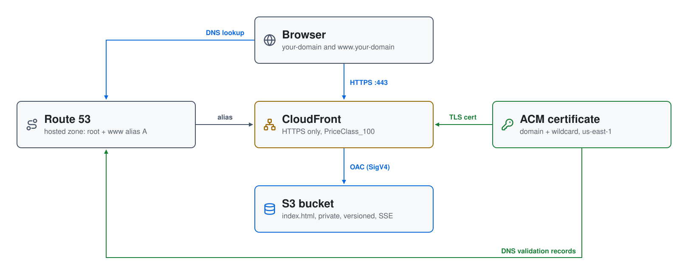

# Static Website on AWS: S3 + CloudFront + ACM

A secure static website built with Terraform: the content lives in a
**private S3 bucket**, **CloudFront** serves it over HTTPS with an **ACM**
certificate, and **Route 53** points your domain and `www` at the
distribution. The only manual step is registering the domain.


| Piece | Where | Role |
|---|---|---|
| **S3 bucket** | us-east-1 | `<domain-with-dashes><account-id>`: holds `index.html`; versioned, AES-256 encrypted, public access blocked; readable only by the distribution |
| **CloudFront distribution** | global | origin is the bucket through Origin Access Control; redirects HTTP to HTTPS; `PriceClass_100`; answers for the domain and `www` |
| **ACM certificate** | us-east-1 (CloudFront requires it) | the domain plus a wildcard, validated with DNS records in the hosted zone |
| **Route 53** | your hosted zone | alias `A` records for the root and `www`, plus the certificate's validation records |

## Architecture

<picture>
  <source media="(prefers-color-scheme: dark)" srcset="architecture-dark.svg">
  
</picture>

Regenerate with `python3 make_diagram.py`.

**`01-website/`** is the whole stack: `bucket.tf` (the bucket, its security
settings, the `index.html` upload and the bucket policy that admits only the
distribution), `acm.tf` (certificate and validation records), and
`cloudfront.tf` (Origin Access Control, the distribution and the alias
records).

## Prerequisites

* [A registered domain](https://docs.aws.amazon.com/Route53/latest/DeveloperGuide/domain-register.html)
  with a Route 53 hosted zone. Registering it in the Route 53 console
  creates the zone; the video walks through this step.
* [An AWS Account](https://aws.amazon.com/console/)
* [Install AWS CLI](https://docs.aws.amazon.com/cli/latest/userguide/getting-started-install.html)
* [Install Terraform](https://developer.hashicorp.com/terraform/install)
* [Install jq](https://jqlang.github.io/jq/download/)

If this is your first time watching our content, we recommend starting with
this video: [AWS + Terraform: Easy Setup](https://youtu.be/BCMQo0CB9wk).

## Deploy

```bash
git clone https://github.com/mamonaco1973/aws-website.git
cd aws-website
export TF_VAR_domain_name="mikes-cloud-solutions.com."   # your hosted zone, with the trailing dot
./apply.sh
```

`domain_name` has no default; without `TF_VAR_domain_name`, Terraform asks
for it. The certificate's DNS validation and the CloudFront deployment take
the longest. When it finishes, Terraform prints:

```
website_url = "https://www.mikes-cloud-solutions.com"
```

## Try it

Open `https://your-domain` or `https://www.your-domain`: the "Under
Construction" page from `01-website/index.html`. Replace that file and run
`./apply.sh` again to publish your own content.

## Troubleshooting

| Symptom | Fix |
|---|---|
| `apply.sh` hangs on the certificate validation | The hosted zone must be the domain's authoritative zone; check that the registrar's name servers match the zone's NS records. |
| The site returns `AccessDenied` | Use the domain, not the bucket URL: the bucket only admits the CloudFront distribution. |
| An updated page doesn't show | CloudFront caches it; create an invalidation for `/*` or wait for the cache to expire. |

## Teardown

```bash
./destroy.sh     # destroys everything Terraform built; the domain and hosted zone stay
```
