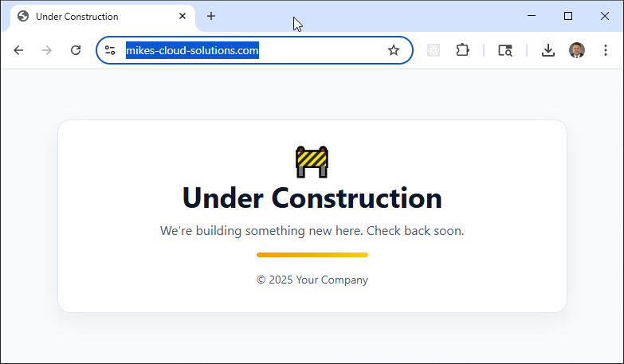
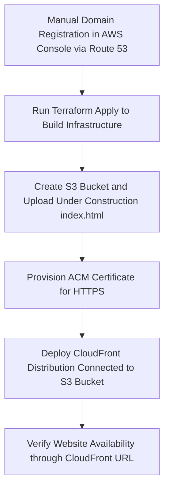

## Simple Website in AWS with Terraform & CloudFront

This project automates the deployment of a fully secure, production-ready **static website on AWS**, leveraging **Terraform** for infrastructure-as-code and **CloudFront** for global HTTPS delivery. The site’s content is hosted in an **Amazon S3 bucket**, served through **CloudFront** with an **ACM-issued SSL certificate**, ensuring fast and secure access from anywhere in the world.

The included Bash scripts (`apply.sh`, `check_env.sh`, and `destroy.sh`) streamline the full lifecycle — from environment validation and provisioning to clean teardown — making this an ideal foundation for static website hosting, personal portfolios, or documentation portals.

**Note:** The only manual step in this process is **domain registration**. This project assumes you register your domain manually in the AWS Management Console (via Route 53). Once the domain is created and the hosted zone exists, Terraform takes over — automating the rest of the deployment, including S3 storage, CloudFront distribution, and ACM certificate provisioning.   In the accompanying video tutorial, we walk through these manual domain registration steps in detail before moving into the Terraform automation.

## Key Features

- **Manual Domain Setup**: Domain registration is handled in the AWS console; all other steps are fully automated through Terraform and scripts.  
- **Infrastructure as Code (IaC)**: All AWS resources are defined declaratively in Terraform for reproducibility and version control.  
- **HTTPS Everywhere**: Automatically provisions an SSL certificate via AWS Certificate Manager (ACM) and enforces HTTPS through CloudFront.  
- **Secure Origin Access**: Uses CloudFront Origin Access Control (OAC) to restrict direct S3 access, protecting the site from public exposure.  
- **Automated Lifecycle**: Shell scripts manage build, validation, and teardown, simplifying infrastructure operations.  

## Prerequisites

* [A Registered Domain](https://docs.aws.amazon.com/Route53/latest/DeveloperGuide/domain-register.html)
* [An AWS Account](https://aws.amazon.com/console/)
* [Install AWS CLI](https://docs.aws.amazon.com/cli/latest/userguide/getting-started-install.html) 
* [Install Latest Terraform](https://developer.hashicorp.com/terraform/install)

If this is your first time watching our content, we recommend starting with this video: [AWS + Terraform: Easy Setup](https://youtu.be/BCMQo0CB9wk). It provides a step-by-step guide to properly configure Terraform, Packer, and the AWS CLI.

## Deployment Flow

